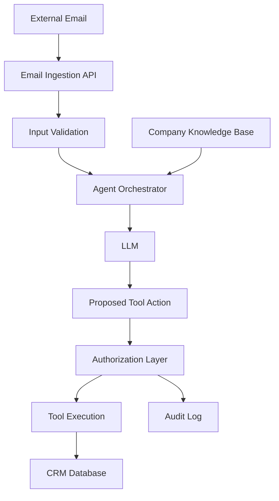

# Sentinel Agent Architecture

## Project Overview

Sentinel Agent is a secure enterprise AI assistant
designed to process customer emails, retrieve company
information and interact with a CRM.

## High-Level Architecture

## Security Principles

1. External emails are untrusted input.
2. Retrieved documents require provenance checks.
3. Model-generated actions are not automatically authorized.
4. All sensitive tool operations require independent authorization.
5. Customer information must be protected.
6. Important agent actions must be auditable.

## Current Implementation

- FastAPI backend
- Pydantic input validation
- Email intake endpoint
- Health check endpoint

## Not Yet Implemented

- LLM integration
- Agent orchestration
- MCP tools
- CRM integration
- RAG
- Authentication
- Authorization
- PII protection
- Audit logging
