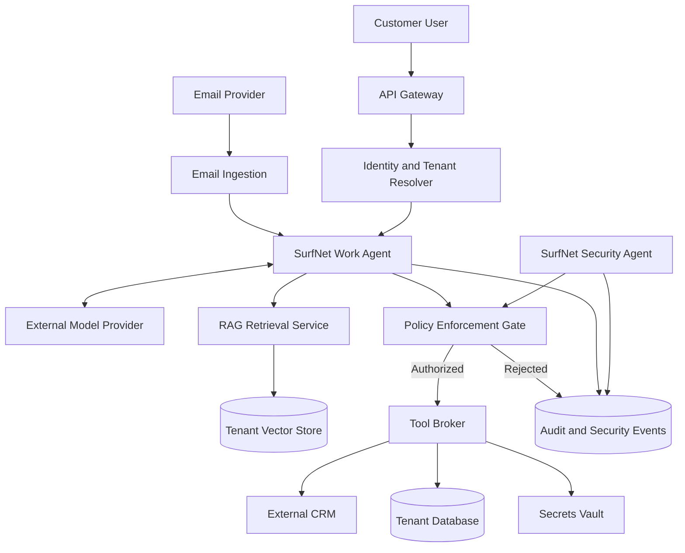

# SurfNet Agent — Data Flow Diagram

Version: 0.1  
Status: Initial architectural threat model

## 1. Purpose

This document describes the major components, external
entities, data flows and trust boundaries of SurfNet Agent.

## 2. External Entities

- Customer and business users.
- Email providers.
- CRM providers.
- Identity providers.
- External model providers.

## 3. Application Processes

- API Gateway.
- Identity and Tenant Resolver.
- Email Ingestion Service.
- SurfNet Work Agent.
- SurfNet Security Agent.
- RAG Retrieval Service.
- Policy Enforcement Layer.
- Approved Tool Broker.

## 4. Data Stores

- Tenant PostgreSQL Database.
- Tenant-isolated Vector Store.
- Protected Audit and Security Event Store.
- Secrets Vault.

## 5. Logical Data Flow

## 6. Trust Boundaries

### TB01 - External to SurfNet

Between external users, email providers, identity providers,
CRM integrations and the SurfNet platform.

### TB02 - Work Agent to Policy Enforcement

Model-generated tool requests must be independently validated
and authorized.

### TB03 - Work Agent and Security Agent

The two agents have distinct service identities and permission
scopes.

### TB04 - SurfNet to Tenant Data

Database and vector retrieval must enforce tenant-level
authorization.

### TB05 - SurfNet to External Model Provider

Information sent to external inference services must follow
data minimization and privacy policies.

## 7. Data Classification

Public:
- General product information.

Internal:
- Application metadata.
- Operational configurations.

Confidential:
- Business documents.
- CRM records.
- Internal customer communications.

Restricted:
- Passwords.
- API secrets.
- Authentication tokens.
- Highly sensitive personal information.

## 8. Security Assumptions

- Tenant identity is established from authenticated context.
- External content is untrusted by default.
- Model-generated tool calls are untrusted proposals.
- Every sensitive action receives independent authorization.
- Tenant data is not automatically available to the Security Agent.
- Security events are protected from unauthorized alteration.

## 9. Current Implementation Status

The current FastAPI skeleton implements only an email
intake endpoint and health-check endpoint.

The other services and integrations represent the
planned product architecture and are not yet implemented.
